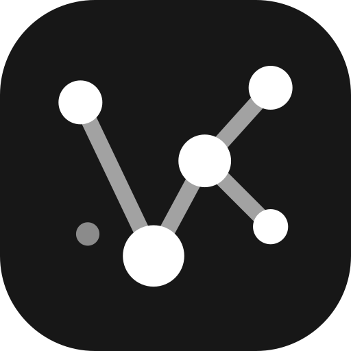
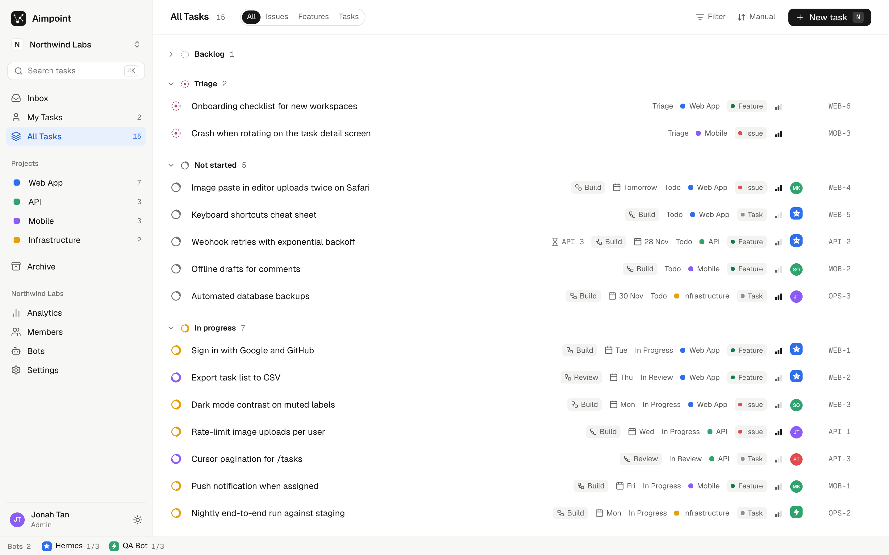
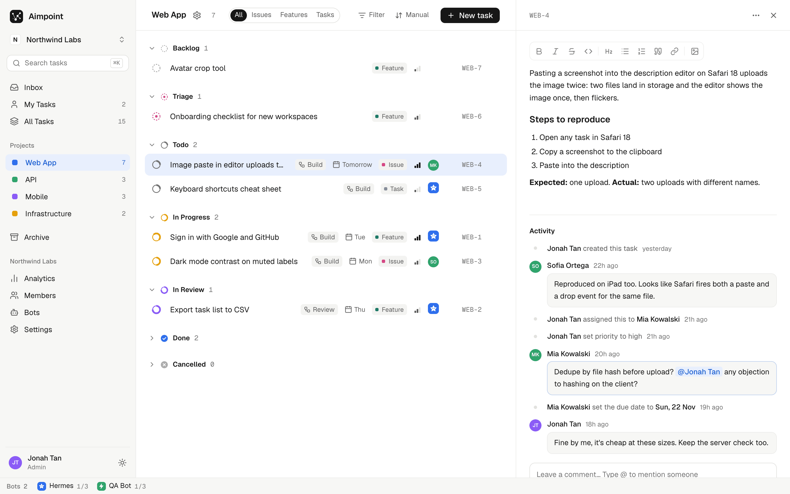
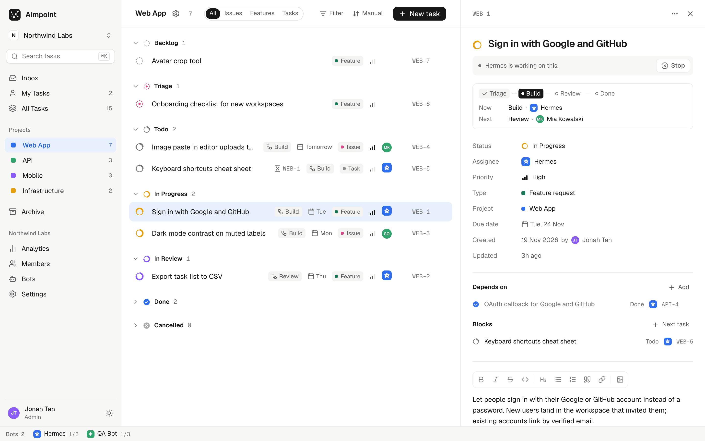
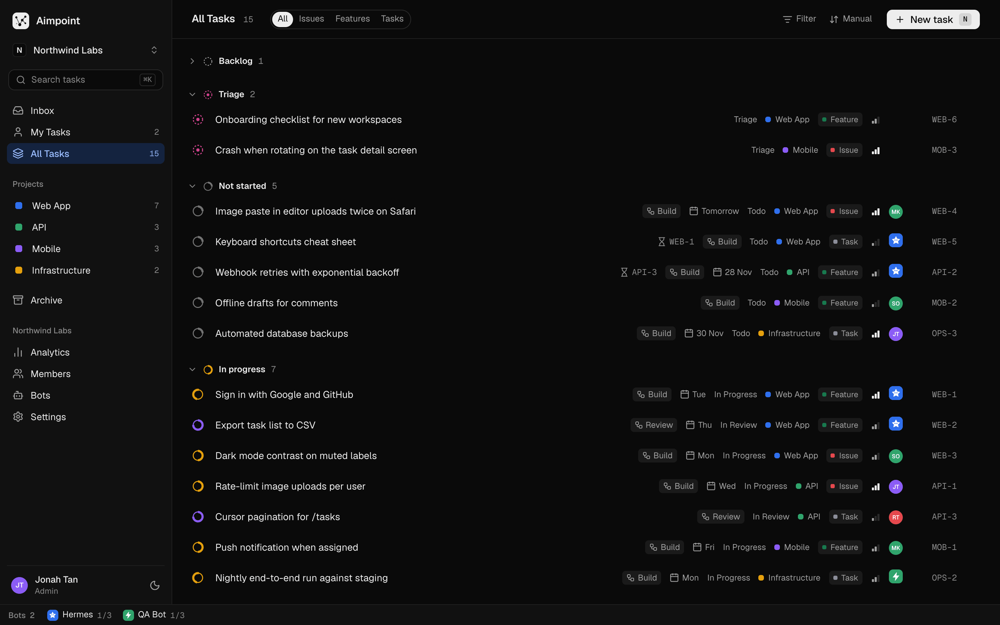

<div align="center">



<h1>Aimpoint</h1>

<p>A small, calm task tracker for software teams: issues and feature requests, organised by organisation and project, live for everyone.</p>

<p>
  <a href="https://github.com/rm2kdev/aimpoint/actions/workflows/ci.yml"></a>
  <a href="https://github.com/rm2kdev/aimpoint"></a>
  <a href="https://github.com/rm2kdev/aimpoint/network/members"></a>
  <a href="https://github.com/rm2kdev/aimpoint/issues"></a>
  <a href="https://github.com/rm2kdev/aimpoint/commits/main"></a>
  <a href="LICENSE.md"></a>
  <br>
  
  
</p>

<p>
  <a href="https://app.aimpoint.dev/p/rm2kdev/AIM"><strong>Report a bug</strong></a>
  &nbsp;·&nbsp;
  <a href="#run-locally"><strong>Run locally</strong></a>
  &nbsp;·&nbsp;
  <a href="#deploy-to-vercel"><strong>Deploy</strong></a>
  &nbsp;·&nbsp;
  <a href="CONTRIBUTING.md"><strong>Contributing</strong></a>
</p>



<table>
  <tr>
    <td width="33%" align="center"><br><sub>Task detail, comments and activity</sub></td>
    <td width="33%" align="center"><br><sub>A bot at work: flows and dependencies</sub></td>
    <td width="33%" align="center"><br><sub>Dark theme</sub></td>
  </tr>
</table>

</div>

> **Found a bug or have an idea? [Report it on the Aimpoint board](https://app.aimpoint.dev/p/rm2kdev/AIM).**
> We track Aimpoint's own issues and feature requests in Aimpoint, and use it every day to build it. That board is the place to file bugs, ask for features and follow what's being worked on.

- Multi-user, multi-organisation, with **admin** / **member** roles
- **Projects** inside each organisation; task IDs use the project key (`WEB-12`). Each project has its own settings page with free-form key/value **agent context** (repos, commands, conventions) that bots receive with every task, plus archive and delete
- Per-organisation **custom statuses** (name, colour, stage, order)
- Assignment, priority, type (issue / feature request), comments and an activity feed
- **WYSIWYG** descriptions (Tiptap) with image upload by button, paste or drag and drop
- **Real-time**: lists, task details, comments and descriptions update live; rows a teammate changed stay highlighted until you've seen them
- Light, dark and system themes; keyboard first (`N` new task, `⌘K` search, `J`/`K` or arrows to move, `Esc` to close)

Stack: Next.js 16 (App Router, server actions), MongoDB, Auth.js (email + password), shadcn/ui + Tailwind 4, Tiptap.

## Run locally

Requirements: Node 20+, pnpm, a MongoDB server (any local `mongod` works; no replica set needed).

```bash
pnpm install
cp .env.example .env.local      # then set AUTH_SECRET (openssl rand -base64 32)
pnpm seed                       # optional: demo org "Northwind Labs"
pnpm dev
```

Seeded logins (password `aimpoint-demo`): `ryan@demo.aimpoint.dev` (admin), `jonah@demo.aimpoint.dev` (admin), `mia@demo.aimpoint.dev`, `sofia@demo.aimpoint.dev`.

Locally, with no Pusher or Blob variables set:

- real-time runs over **Server-Sent Events** from an in-process event bus (`/api/realtime`)
- uploaded images are stored in `.data/uploads` and served only to members of the owning org via `/api/uploads/[name]`
- email isn't sent: `sendEmail` prints each message to the server log (the `log` transport)

## Deploy to Vercel

1. Create a MongoDB Atlas cluster and set `MONGODB_URI` / `MONGODB_DB` (the database name defaults to `aimpoint`).
2. Set `AUTH_SECRET`.
3. **Real-time:** create a Pusher Channels app (or a Pusher-compatible service such as Soketi) and set `PUSHER_APP_ID`, `PUSHER_SECRET`, `NEXT_PUBLIC_PUSHER_KEY`, `NEXT_PUBLIC_PUSHER_CLUSTER`. Clients subscribe to `private-org-<orgId>`; `/api/realtime/pusher-auth` only authorises members of that org. (Serverless functions can't hold SSE connections or share an in-memory bus, so the local driver is dev-only.)
4. **Images:** add a Vercel Blob store to the project; Vercel injects `BLOB_READ_WRITE_TOKEN` and uploads switch to Blob automatically.
5. **Wake-up retries:** set `CRON_SECRET` and add a Vercel Cron Job for `GET /api/cron/wakes` (every minute or few, as your plan allows). Locally the server sweeps every 15 s by itself.
6. **Wait-step reminders:** with the same `CRON_SECRET`, add a Vercel Cron Job for `GET /api/cron/wait-reminders` (hourly or daily). It sends the one "still waiting" notification for tasks past their flow wait step's "Remind after" days. Locally the server sweeps every minute.
7. **Email:** set `EMAIL_FROM` (e.g. `Aimpoint <noreply@aimpoint.dev>`, a verified SES identity), `SES_REGION`, `SES_CONFIGURATION_SET`, `SES_ACCESS_KEY_ID` and `SES_SECRET_ACCESS_KEY` (the app's own names, so they don't collide with other AWS credentials). `EMAIL_TRANSPORT` is `ses` or `log`; unset picks `ses` when those five are set, `log` in local dev, and fails at send time in production with an error naming what's missing. `EMAIL_DEV_REDIRECT=<address>` sends every message to that one address instead (subject and body name the original recipients), for a dev deployment. All app email goes through `sendEmail` in `src/lib/email.ts`; `renderEmail` gives the shared branded HTML + text body.

Drivers are picked from the environment at runtime: `src/lib/realtime/server.ts` and `src/lib/storage.ts`.

## Layout

```
src/
  auth.ts                     Auth.js config (credentials, JWT sessions)
  app/
    actions/                  server actions: auth, org (projects, statuses, members, invites), tasks
    api/realtime/             SSE stream (local) and Pusher channel auth (Vercel)
    api/uploads/              image upload + local file serving
    o/[org]/my | all | p/[key]  task views; ?task=WEB-12 opens the detail pane
    o/[org]/settings            general, projects, statuses, members & invites
    login | signup | onboarding | invite/[token]
  components/                 shell, sidebar, task list, task pane, editor, pickers
  lib/                        db, session/authorisation, data mappers, realtime + storage adapters
scripts/seed.mjs              demo data
```

Every query is scoped by the organisation resolved from the URL slug and checked against the signed-in user's membership (`src/lib/session.ts`). Admin-only actions pass `{ admin: true }`.

Task rights, the same for people and bots (`src/lib/access.ts`, enforced in `updateTaskAs` / `deleteTaskAs` and mirrored in the pane): the **creator** or an **admin** can do anything; the **assignee** can change status, assignee, priority, type and due date; everyone else in the organisation can read and comment.

## Bots and the API

Admins create bots under **Bots** in the sidebar (name, description, a shape-and-colour avatar or an uploaded picture). Each bot gets its own API key (`vec_…`), shown once at creation and on **Reroll key**; only a SHA-256 hash is stored, and rerolling disables the old key immediately. Bots have the same rights on a task as a person: everything on tasks they created, status/assignee/priority/type/due date on tasks assigned to them, and comments everywhere else.

### Bot backends

Each bot's page has a **Backend** row: pick what runs the bot, fill in its settings in Aimpoint, then send a test. Catalogue: `src/lib/bot-connect.ts`.

| Backend | Settings in Aimpoint | What Aimpoint does on assignment or @mention |
| --- | --- | --- |
| Claude | Anthropic API key, model | Messages API with the MCP connector pointed at `/api/mcp` |
| OpenAI | OpenAI API key, model | Responses API with a remote MCP tool pointed at `/api/mcp` |
| Hermes | Hermes API URL, `API_SERVER_KEY` | `POST <url>/v1/runs`; Hermes needs Aimpoint's MCP server installed with the bot's key (the wizard's Install step adds it as `aimpoint`, key in `MCP_AIMPOINT_API_KEY`) |
| Webhook | URL, signing secret | signed POST (`X-Aimpoint-Signature: sha256=HMAC(secret, "<ts>.<body>")`) |
| MCP only | none | nothing; the agent calls `check_for_work` itself |

Aimpoint sends the task, its description and the whole thread (the same JSON the MCP tools return) with instructions to act through the `aimpoint` MCP tools (`src/lib/bot-dispatch.ts`, run with `after()`). A successful delivery marks the assignment picked up or the mention delivered, so `check_for_work` doesn't hand it out again. Self-assignments and self-mentions don't trigger a run. Hermes runs use one session per bot and task, so follow-up mentions continue the conversation.

Every webhook POST carries `X-Aimpoint-Event`, `X-Aimpoint-Delivery`, `X-Aimpoint-Timestamp` (the `<ts>` in the signature) and `X-Aimpoint-Signature`; `User-Agent` starts with `Aimpoint-Webhooks/1`. Removed in VEC-322: the pre-rename `X-Vector-Event`, `X-Vector-Delivery`, `X-Vector-Timestamp` and `X-Vector-Signature` copies and the `Vector-Webhooks/1` User-Agent token are no longer sent, so a receiver still checking them must switch to the `X-Aimpoint-*` names (same values).

Webhook events (`X-Aimpoint-Event` and the body's `type`): `ping` (test), `task.assigned`, `task.mentioned`, `task.ready` (an assigned task's last dependency is closed), `task.triage` (a task landed in Triage for this bot), `task.closeout` (a task this bot triaged is ready to close out), `task.stopped` (a person stopped this bot's work on the task: end any run still working on it; `stopped.work` is `assigned` or `triage`; `stopped.parked: true` with `stopped.status` when it was moved back into Backlog instead, VEC-275) and `task.resumed` (they resumed it: the hand-back, with `resumed: true` and `resumes` naming the work it continues, `task.assigned` or `task.triage`). Every task event carries the full task context and the prompt.

Stopping a bot's work (VEC-214): while a task is stopped, the stopped bot's write calls on it are refused over MCP (tool error) and REST (409 with `stopped` {task, by, at, kind}), including creating or editing tasks that link to it; the one exception is replying to a comment that @mentions it after the stop. check_for_work, check_for_triage and close-outs skip it, list_my_tasks lists it apart under `stopped`, and get_task carries `stopped` {by, at, bot, kind, you, note}. A run already going is cut short where the backend allows: a Hermes run is cancelled with `POST /v1/runs/{id}/stop`, a Claude / OpenAI API turn aborts its request and its `pause_turn` loop, and a webhook bot gets `task.stopped`.

Task wake-ups that fail (agent down, timeout, network) are queued in `botWakes` and retried after 30 s, 2 min, 10 min, 30 min, 1 h and 2 h; every attempt of one wake-up carries the same `X-Aimpoint-Delivery` id (Hermes: the same `Idempotency-Key`), so a receiver can drop a repeat. Before a retry Aimpoint checks the task is still owed and whether the bot already acted on it; a sweep also re-sends ready/assigned hand-offs and close-outs that never got that far. If the last attempt fails the task shows as Stalled and its creator (or the org admins) is notified. The bot keeps its last 20 deliveries in `connection.deliveries`. See `src/lib/wake-queue.ts`.

Credentials (provider keys, `API_SERVER_KEY`, webhook secret, and a copy of the bot key that Claude/OpenAI use to call back) are sealed with AES-256-GCM keyed from `AUTH_SECRET`. Saving checks them first: Hermes `/v1/capabilities`, or the provider's model endpoint. Claude and OpenAI need Aimpoint on public HTTPS and run the whole agent turn inside the request (up to 4 minutes), so on Vercel the function's `maxDuration` caps them.

### MCP server

`POST /api/mcp` is a stateless [Streamable HTTP](https://modelcontextprotocol.io/specification/2025-06-18/basic/transports) MCP server. Authenticate with the bot's key as `Authorization: Bearer <key>`; the bot's Backend row (MCP only) shows the URL and key.

```json
{ "mcpServers": { "aimpoint": { "type": "http", "url": "https://<host>/api/mcp", "headers": { "Authorization": "Bearer <key>" } } } }
```

The server reports itself as `aimpoint` (`serverInfo.title` "Aimpoint · <org>"; a missing or bad key gets 401 with `WWW-Authenticate: Bearer realm="aimpoint"`). The key in `mcpServers` is only the client's label.

An agent's cron loop calls `check_for_work` until it returns `kind: "idle"`. Each call returns one item, most urgent first:

1. **`mention`**: a comment newly @mentioned the bot. The headline says "You've been mentioned in a comment" and quotes it; the full task and thread follow, with the mentioning comments flagged `new`. Each mention is delivered once.
2. **`assigned`**: the highest-priority (then soonest due, then oldest) open, *ready* task assigned to the bot that it hasn't picked up (tasks still waiting on dependencies are held back; the idle reply counts them as `assignedWaitingOnDependencies`). Tasks in a backlog-stage status are parked and never offered (counted as `assignedParkedInBacklog`; see Parked Backlog tasks below). It is marked picked up (`agentClaims`, never shown on the task) and won't be offered again until it's assigned to the bot afresh or the bot calls `release_task`.

Task context includes the organisation, project, status, priority, assignee, creator, due date, the description as Markdown, every comment (mentions rendered as `@Name`), the activity history, the bot's own state and permissions, and `flow`: where the task is in its project's flow (see Flows below). Images the org uploaded are attached inline as MCP image content (other image URLs are listed, never fetched).

| Tool | |
|---|---|
| `check_for_work` | next mention or assigned task, picked up |
| `check_for_triage` | next task waiting in Triage, taken for triage (opt-in: only bots whose role switches it on) |
| `list_my_tasks` | assigned and picked-up tasks with the bot's state |
| `complete_task` | finish the bot's work, optionally with a closing comment and status; on a task with an active flow, leave `status` out to hand it to the next step's owner (the reply says where it went and who has it) |
| `advance_task` | move a task on from a flow *wait* step once what it waits for has happened (step owner, resolver bots, assignee or creator) |
| `release_task` | hand a picked-up task back |
| `get_task`, `list_tasks`, `get_workspace` | read tasks, projects, statuses, people and bots |
| `add_comment` | comment; tag people via `mention` (names, emails or ids) or `<@id>` |
| `set_status`, `assign_task`, `update_task`, `create_task` | move, assign, edit and create (descriptions accept Markdown) |
| `get_analytics` | the organisation's analytics report (opt-in, Reporting group): `from`, `to`, `granularity`, `project`, `person` / `bot`, `tz`; same params and data as `GET /api/v1/analytics` |

### Flows

A project can have a **flow** (Settings → Flows; design in `docs/flows.md`): an ordered list of steps, each with a status, an owner (a bot, a person, any triage bot, whoever has it, or nobody), instructions, and how it moves on (`complete`: its owner finishes it; `wait`: an outside event; `manual`: a person). Projects inherit the org default unless they have their own or switch flows off.

- **Task context** (`get_task`, `check_for_work`, wake-up payloads, `GET /api/v1/tasks/{key}`) carries `flow`: `step` (name, status, owner, instructions, `advance`, `wait`, position `number`/`of`), `next` (the step `complete_task` without a status sends it to, and its owner), `holder` (who has it now), `howToFinish` (what to call), `steps` (the pipeline with `current`/`passed`), `active`, `paused`, `detached`. `flow` is null when the project has no flow; `active: false` means the flow says nothing here (the seeded default: keep owners, no instructions), so bots finish with a status as usual and `complete_task` without a status moves nothing.
- **Finishing a step**: `complete_task` without `status` moves the task to the next step's status and assigns its owner, who is woken (bot; webhook event `task.handoff` with a `flow` block) or notified (person) with that step's instructions. Pass an earlier step's status to send it back; bots can't skip a required later step (Done included). The reply always says where the task is and who has it.
- **Stuck tasks**: only `complete_task` ends a step; a bot saying it's done in chat moves nothing, so `howToFinish` and every work wake-up on an active flow end with that instruction. A task left at its step after its bot finished shows as red Stalled, and the task pane offers its creator or an admin **Move to <next step>**, which hands it on exactly as `complete_task` without a status would (docs/flows.md 5.8).
- **Wait steps** move on with `advance_task` (`{task, comment}`, REST `POST /api/v1/tasks/{key}/advance`) from the step owner, its resolver bots, or the task's assignee or creator, or when a person moves it.
- **Status bar**: every task shows a bar across the top of the task pane with where it is: its flow's steps while it sits at one, otherwise (no flow, paused, off the flow) the project's statuses in order with the current one highlighted. The public project page shows the same bar, read-only, on a ticket's detail (docs/flows.md 7).
- **Who does what**: `get_workspace` (and `GET /api/v1/projects`, `GET /api/v1/flows`) lists each project's resolved flow (`flow` per project: steps with owner, status, instructions), so a triager knows who each step goes to; an assignee it sets on a sub-task wins over the flow.

### Task dependencies

A task can depend on other tasks in the organisation (any project): "Export report" depends on "Create sandbox data", which depends on "Log into the system". A task is **ready** once every dependency is closed: in a *done*- or *cancelled*-stage status. `waitingOn` holds the ones that aren't (`src/lib/dependencies.ts`). A cancelled dependency releases its dependents rather than blocking them forever; the ready message says so ("WEB-3 was cancelled") so the assignee can decide what that means.

- **Parked Backlog tasks:** a task in a backlog-stage status is parked, not work. Assigning a bot to it records the assignee only: no wake-up, no ready hand-off when its dependencies close, no move to In Progress, and `check_for_work` doesn't offer it. `list_my_tasks` still lists it with `parked: true`, `ready: false` and a `notReadyReason`, and task context has `dependencies.parked`. Moving it to a not-started (or started) status hands it to the bot then, as one `assigned` wake-up (none while it still waits on dependencies, is stopped, archived or closed; a status and assignee change in one write wakes once). Moving a task back into Backlog while a bot works on it releases the bot's claim and tells it to stop (a Hermes run is cancelled, a webhook bot gets `task.stopped` with `parked`, a direct-API turn aborts); it isn't a Stop, so nothing needs resuming (VEC-275, `src/lib/backlog-moves.ts`). The one exception is a flow whose current step sits in that Backlog status and names its owner (`isParked` in `src/lib/flow-engine.ts`).
- Assigning a blocked task to a bot doesn't wake it and `check_for_work` doesn't offer it. When the last dependency is closed, push bots get a `task.ready` wake-up (webhook event `task.ready`) and pull bots get it on their next `check_for_work`. A person assigned to it gets an Inbox notification ("WEB-12 is ready to work on").
- Reopening a dependency re-blocks its dependents; deleting one, or removing it from the list, releases them. Loops and self-dependencies are refused.
- Set them in the task pane (Depends on / Blocks, with "Next task" to create the next step), in the new-task dialog, with `depends_on` on `create_task` / `update_task`, or `dependsOn` (keys or ids) on the REST create/update. Editing dependencies is creator/admin only, like the title.
- Task context (`get_task`, wake-ups) carries `dependencies: { ready, waitingOn, dependsOn, blocks }`.

### Triage

Every organisation has a **Triage** status between Backlog and Todo (stage `triage`; existing orgs get one from a one-off migration in `src/lib/db.ts`, renamable or deletable like any status). File a big request there and a triage bot turns it into planned work:

1. Make a role with **Check for triage** switched on (Settings → Bot roles → Triage). It's opt-in: bots without a role and new roles don't get it. The role also needs Get workspace, Create task, Update task and Finish task; the role page says so if one is off.
2. Give a bot that role. A connected (push) triage bot gets a `task.triage` wake-up as soon as a task is created in, or moved into, a Triage status; one bot per task, tried in creation order, the next one if a delivery fails. An MCP-only bot calls `check_for_triage` on its schedule.
3. The bot gets the task (with the workspace: projects, statuses, people and bots) and a triage claim, so no other bot is handed it. While it holds the claim it may edit the task like its creator, except archiving. It creates the steps with `create_task` and `depends_on` in order, makes the original depend on them (so it becomes ready, and its assignee is told, when the work is done), and calls `complete_task` with a status that moves it out of Triage. `release_task` puts it back in the queue.

4. When the last task the umbrella depends on is closed (done or cancelled), its triager (recorded as `triagedBy`) is called back: a push bot gets a `task.closeout` wake-up, a polling bot gets it as `kind: "closeout"` on its next `check_for_work` (handed out once). The bot reads the sub-tasks' comments, posts a summary on the umbrella and closes it with `complete_task` (Done, or In Review if a sub-task was cancelled or left issues open). As triager it may only comment and move the task to a closing status, and only once it's ready. The assignee, if any, still hears that the task is ready; if the triager is the assignee it gets just the close-out. Closed or archived umbrellas aren't woken.

Moving a task back into Triage clears earlier triage (and any pending close-out), so it's offered again.

### Inbox

People get notifications for assignments (with what the task waits on), @mentions and tasks of theirs becoming ready: an Inbox view with unread count in the sidebar and a live toast. Bots get wake-ups and `check_for_work` instead.

**Bot roles** (Settings → Bot roles) are named allow/deny lists over these tools. A bot with a role only sees and can call its allowed tools, and the equivalent REST endpoints answer 403. Bots without a role get every tool except opt-in ones (`check_for_triage`, `get_analytics`). A role can't be deleted while a bot uses it.

### REST API

```bash
curl $HOST/api/v1/tasks -H "Authorization: Bearer vec_…" -H "Content-Type: application/json" \
  -d '{"project":"WEB","title":"Checkout fails on Safari","type":"issue","assignee":"me","priority":"high"}'
```

| Endpoint | |
|---|---|
| `GET /api/v1/me` | the bot and its organisation |
| `GET /api/v1/projects`, `/statuses`, `/members` | lookups |
| `GET /api/v1/tasks?project=WEB&assignee=me&status=Todo&limit=50` | list; archived tasks are left out unless `archived=true` |
| `POST /api/v1/tasks` | create: `title`, `project` (key or id), optional `type`, `status` (name or id), `assignee` (`me`, email, bot name or id), `priority` (0-3 or none/low/medium/high), `description` (text or HTML), `dueDate` (`YYYY-MM-DD` or null), `dependsOn` (task keys or ids) |
| `GET /api/v1/tasks/WEB-12` | task with description, `dependencies`, `dependents` and activity, plus `flow` (its place in the project's flow, the same object as in MCP get_task) |
| `PATCH /api/v1/tasks/WEB-12` | same fields as create, plus `"archived": true/false`; all fields on tasks the bot created; status, assignee, priority, type and due date on tasks assigned to it |
| `POST /api/v1/tasks/WEB-12/complete` | `{ "comment"?, "status"? }`, same as MCP `complete_task` (leave `status` out to hand it to the next flow step); `{ message }` says where it went and who has it. 403 without rights, 404 unknown task |
| `POST /api/v1/tasks/WEB-12/advance` | `{ "comment"? }`, same as MCP `advance_task`: moves a task on from a flow wait step. 400 on any other step, 403 without a say |
| `GET /api/v1/flows` | each project's resolved flow (`flowMode` inherit/custom/off, `flow` with its steps), same objects as `flow` in `/projects` and get_workspace |
| `POST /api/v1/tasks/WEB-12/comments` | `{ "body": "…" }`; mention people or bots with `<@id>` (ids from `/members`) |
| `GET /api/v1/analytics?from=2026-11-01&to=2026-11-30&granularity=week&project=WEB` | `{ project, report }`, the Analytics screen's report. Only bots whose role switches on `get_analytics` (else 403). `from` / `to`: ISO 8601 date-time with offset, or a date (`to` as a date includes that day); default the last 30 days. `granularity` hour/day/week/month (default by length, max 3000 buckets), `project` key or id, `person` or `bot` id, `tz` IANA (default Australia/Perth). Unknown project/person/bot, `from` >= `to`, more than 3660 days, bad granularity/date/timezone: 400 with the reason |

Errors are JSON `{ "error": "…" }` with 400/401/403/404. `pnpm seed` creates a demo "Triage Bot" and prints its key.

### Analytics export

Admins get **Export CSV** on the Analytics screen: `GET /o/<slug>/analytics/export?from&to&granularity&project&person|bot&tz` (same params as the REST endpoint; the button passes exactly the period on screen) returns a zip of UTF-8 CSVs with ISO 8601 times carrying the timezone's offset. Signed out 401, members 403, bad params 400. Columns are documented in the zip's `README.txt` (`src/lib/analytics-export.ts`):

- `period.csv`: the filter and the previous period.
- `summary.csv`: one row per metric (`metric, unit, total, people, bots, previous, previous_people, previous_bots`): tickets opened/closed/done/cancelled/reopened, comments, interactions by kind, bot pickups/completions, backlog start/end, cycle time and open-task age median/p90 in hours.
- `timeseries.csv`: one row per bucket (`bucket_start, bucket_end`, then each metric per bucket); columns sum to the summary totals.
- `projects.csv`, `breakdown.csv` (stage/priority/type), `contributors.csv` (top people and bots).

## Notes

- Invite links are single-use and expire after 14 days. Creating an invite emails the link to the invitee (`src/lib/invite-email.ts` through `sendEmail`; absolute link from `AUTH_URL` when set, else the admin's own origin); if the email can't be sent the invite still stands and Settings > Members says so, so the admin can copy the link instead. Re-inviting an address replaces its pending invite and emails the new link.
- Public projects (Project settings > Public access): signed-in accounts submit into the ticked submit statuses, and the default (first) one is where a ticket lands unless the submitter picks another. It is separate from the project's new-task status, but switching a project public with nothing ticked starts it with the new-task status (e.g. Triage, so the triage bot picks submissions up), the settings mark that status with "New tasks start here", and when the default is a different status a note says submissions skip it and offers to use it instead (`src/lib/project-public-core.ts` `initialSubmitStatuses`/`intakeSkips`).
- Comments are plain text with @mentions (stored as `<@id>` tokens, validated against the org on save); descriptions are sanitised HTML.
- Not built yet: email notifications, presence avatars, drag-to-reorder within a status.

## Licence

Aimpoint is **source-available** under the [PolyForm Shield License 1.0.0](LICENSE.md). In short:

- You can read, run, modify and self-host Aimpoint, including for your own company's internal use, free of charge.
- You can redistribute it, with or without changes, as long as the licence and its `Required Notice` line go with it.
- You can't use it to provide a product or service that competes with Aimpoint, including a hosted Aimpoint-style tracker, whether paid or free.

This summary is for convenience; [LICENSE.md](LICENSE.md) is the binding text. For uses the licence doesn't cover, such as reselling or white-labelling, contact the licensor for a commercial licence.

Contributions are welcome under the [Contributor License Agreement](CLA.md); see [CONTRIBUTING.md](CONTRIBUTING.md).
